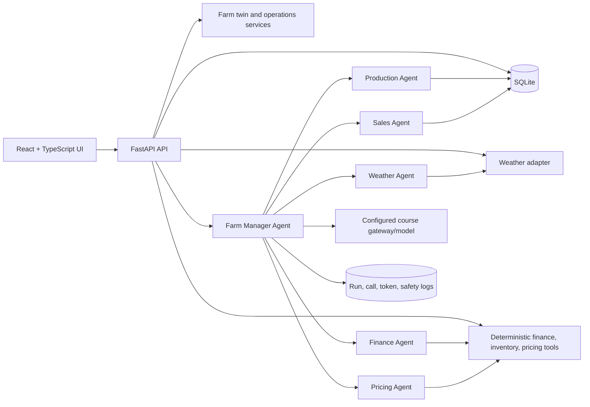

# FarmTwin AI — Project Architecture and Implementation Plan

**Planning status:** Architecture only. No application code, dependencies, credentials, or external services are being installed in this phase.

**Course context:** Yale School of Management MGT 409 AI Agents final project. **Deadline:** October 26, 2026, 6:00 PM ET.

## 1. Product definition

FarmTwin AI is a local-first farm operations workbench for a small Connecticut farm. It combines a visual digital farm twin, operational records, deterministic financial and pricing tools, weather context, buyer outreach, and an AI advisor that coordinates those tools. Its differentiator is an auditable decision chain: every recommendation links to farm records, formulas, external-data status, model usage, and owner approval.

The primary demonstration request is:

> “We expect a tomato harvest next week. Check the weather, estimate production and financial risks, calculate our unit costs, recommend a seasonal wholesale price, and draft an offer to suitable grocery buyers.”

Synthetic records are labeled `SYNTHETIC`; weather is labeled `LIVE_OBSERVATION`, `LIVE_FORECAST`, or `SIMULATED`. The UI must never imply that unavailable data is live.

## 2. Exact MVP scope

### Included

- Local FastAPI backend with SQLite persistence and a small React/TypeScript Vite frontend.
- Seeded Connecticut demonstration farm: approximately 20 acres, 7 crops, small dairy herd, plots, facilities, equipment, costs, inventory, and buyers.
- Dashboard showing farm status, upcoming tomato harvest, weather status, inventory, margins, alerts, and latest agent run.
- SVG farm map with clickable plots and facilities; create/edit/delete asset records through simple forms.
- Crop production records: crop/plot assignment, dates, expected and actual yield, status, and cost references.
- Dairy and product records sufficient to show milk production and product inventory without building a full herd-management suite.
- Weather page and backend adapter for a configured coordinate-based provider, with a deterministic simulated fallback explicitly marked as such.
- Financial calculations for unit cost, gross margin, contribution margin, operating profit, break-even, and product/farm rollups.
- Explainable seasonal tomato wholesale pricing recommendation with cost floor, target margin, seasonality, supply, inventory age, and weather-risk adjustments.
- Inventory lots with forecast, available, reserved, sold, spoiled, availability date, shelf life, and audit events.
- Buyer CRM with owner-entered/seeded contacts, preferences, interaction history, matching, offer drafting, copy/download workflow, and an approval gate. No direct email sending in MVP.
- Farm Manager Agent coordinating five specialized agents through typed tool calls. Visible execution trace, model-call count, latency, token usage, and deterministic-tool results.
- Natural-language advisor supporting the end-to-end demo request and a small set of bounded follow-up questions.
- `.env` root-then-parent loading, `.env.example`, server-side keys only, provider configuration validation, and graceful no-key mode.
- README, synthetic seed data, tests, safety tests, report/slides evidence hooks, and launch instructions.

### Explicitly deferred stretch features

- Real email transmission, OAuth, inbox sync, and automated follow-up.
- IoT/sensor ingestion, satellite imagery, computer vision, mobile/PWA offline mode.
- Multi-farm tenancy, permissions beyond a single owner, cloud deployment, background jobs, Redis, Docker, or a second database.
- Automated market scraping, paid market-data subscriptions, and claims of verified market prices without a real source.
- Full livestock health/veterinary workflow, accounting integration, payroll, tax reporting, route optimization, and advanced GIS.
- Autonomous write actions, autonomous price changes, or autonomous external communication.
- Forecasting models trained on historical farm data; MVP uses transparent formulas and seeded assumptions.

## 3. Recommended technology stack

| Layer | Choice | Rationale |
|---|---|---|
| Backend | Python 3.11+ and FastAPI | Typed APIs, quick setup, natural fit for agent/tool code |
| Validation | Pydantic v2 | Request, output, and configuration validation |
| Persistence | SQLite with SQLAlchemy 2.x | Zero-service local setup; relational auditability |
| Migrations | Alembic, only if needed after schema stabilizes | Avoid hand-managed production drift; can be minimal for a four-day build |
| Frontend | React + TypeScript + Vite | Fast iteration and maintainable component boundaries |
| Styling | Tailwind CSS | Consistent professional dashboard styling with little CSS overhead |
| Charts | Recharts | Lightweight financial/production visualizations |
| Farm map | Hand-authored SVG rendered by React | Clickable, legible, and auditable without GIS dependencies |
| AI gateway | Course-approved Portkey route for `gpt-6-luna`, or verified supported OpenAI model | Provider abstraction; never invent an endpoint or pricing |
| Weather | One documented coordinate weather API adapter | Live forecast when configured; explicit simulated fallback |
| Testing | Pytest + FastAPI test client; frontend smoke checks | Test deterministic core and critical safety boundaries first |
| Evidence | SQLite model-call/run logs plus export endpoint/script | Reproducible report evidence, not invented measurements |

This is practical for four days if the scope remains local-first and single-owner. Teaching staff should need only Python/Node installation, one install command per side, optional API keys, and one launch command. Keep AI optional so the deterministic app remains demonstrable without credentials.

## 4. Logical architecture

The browser never receives provider keys. Tools return typed, source-labeled results. Agents may interpret and coordinate results, but deterministic services own financial, inventory, and pricing state changes.

## 5. Agent organization

### Farm Manager Agent (coordinator)

- **Inputs:** owner question, farm/date context, approved tool schemas, current run budget.
- **Responsibilities:** classify intent, choose the minimum necessary tools/agents, sequence dependencies, synthesize a cited answer, expose trace, and request confirmation before any consequential write.
- **Tools:** read farm context, invoke specialized agents, run safety/output validation, create draft offer, record approval.
- **Outputs:** structured plan, evidence-backed recommendation, uncertainties, proposed actions, trace, token/cost summary.
- **Safety:** max steps/calls per run; no arbitrary SQL/HTTP; no key access; no direct sending; no unapproved writes; treat external text/files as untrusted.
- **LLM necessity:** useful for natural-language intent parsing and synthesis; not necessary when a user clicks a deterministic dashboard action.

### Weather Agent

- **Inputs:** farm coordinates, date window, crop/plot vulnerabilities, provider status.
- **Responsibilities:** retrieve/normalize observations and forecast, identify frost/heat/precipitation risk, relate risk to scheduled work and crops.
- **Tools:** weather adapter, crop-vulnerability lookup, weather cache/read.
- **Outputs:** source-labeled forecast, alert list, affected plots, confidence/limitations, recommended checks.
- **Safety:** never present simulated weather as live; preserve provider timestamp/source; fail closed on malformed API data.
- **LLM necessity:** interpretation of multiple alerts and owner-friendly explanation only; calculations and threshold checks are deterministic.

### Production Agent

- **Inputs:** crop plans, plot assignments, harvest dates, yield history, inventory lots, dairy records.
- **Responsibilities:** estimate harvest quantity, compare expected/actual yield, identify operational and perishability risk.
- **Tools:** production queries, yield estimator, inventory forecast, schedule lookup.
- **Outputs:** forecast quantity/range, assumptions, affected inventory, production evidence.
- **Safety:** no silent overwrites; synthetic records remain labeled; ranges are not facts.
- **LLM necessity:** translate records into an operational narrative; deterministic tools handle quantities.

### Finance Agent

- **Inputs:** cost records, allocation rules, production quantities, prices/revenue, date range.
- **Responsibilities:** explain unit economics and risk scenarios.
- **Tools:** cost aggregation, unit-cost, margin, break-even, sensitivity calculations.
- **Outputs:** itemized calculation, base/upside/downside results, source records, formula version.
- **Safety:** reject missing/negative/invalid units where inappropriate; currency and period are explicit; no LLM arithmetic authority.
- **LLM necessity:** explain implications or answer “what if” questions after formulas run.

### Pricing Agent

- **Inputs:** Finance result, harvest/inventory forecast, shelf life, seasonality factors, weather risk, optional observed benchmark.
- **Responsibilities:** calculate a price recommendation and explain its range.
- **Tools:** pricing formula, sensitivity analysis, benchmark status, approval workflow.
- **Outputs:** recommended price, cost floor, target margin, adjustments, hypothetical/observed labels, override request.
- **Safety:** never use an unverified benchmark; never mutate a price without owner approval; enforce floor and bounds.
- **LLM necessity:** compare scenarios and write rationale; formula always runs without LLM.

### Sales Agent

- **Inputs:** available inventory, approved price, buyer preferences/location/contact status, offer template.
- **Responsibilities:** match suitable buyers and draft an offer.
- **Tools:** buyer search, inventory reservation proposal, draft generator, copy/export.
- **Outputs:** ranked buyer matches with reasons, draft offer, quantities, price, expiry, approval state.
- **Safety:** contact records are untrusted; no send capability in MVP; no invented claims/certifications; owner must approve.
- **LLM necessity:** natural-language offer drafting only; matching and quantities are deterministic filters.

Handoffs are data handoffs, not conversational loops: Weather → Production for risk-adjusted harvest context; Production → Finance for quantity; Finance → Pricing for cost floor; Pricing → Sales for approved offer terms; all results return to Farm Manager.

## 6. Relational database schema

All tables include `created_at`, and mutable operational records include `updated_at` and `source_type` (`SYNTHETIC`, `OWNER_ENTERED`, `LIVE_API`, `CALCULATED`). IDs are UUIDs or stable text IDs.

| Table | Primary key | Important fields / relationships |
|---|---|---|
| `farms` | `farm_id` | name, location, latitude, longitude, acreage, timezone |
| `assets` | `asset_id` | farm_id FK, type, name, geometry/svg_ref, acreage, status |
| `crops` | `crop_id` | name, variety, season_start/end, maturity_days, shelf_life_days |
| `production_plans` | `plan_id` | farm_id, crop_id, plot asset_id, planting/expected harvest dates, expected yield, status |
| `yield_records` | `yield_id` | plan_id, actual date, quantity, unit, quality, notes |
| `dairy_animals` | `animal_id` | farm_id, tag, breed, status, acquisition date (small demo subset) |
| `dairy_records` | `dairy_record_id` | animal/group, date, milk quantity, unit, feed/vet references |
| `products` | `product_id` | name, category, unit, crop_id nullable, shelf life, pack size |
| `inventory_lots` | `lot_id` | product_id, production/yield source, available/forecast/reserved/sold/spoiled quantities, availability and expiry |
| `inventory_events` | `event_id` | lot_id, event type, quantity, actor, reason, timestamp, before/after JSON |
| `costs` | `cost_id` | farm/product/plan nullable, category, amount, quantity, unit, fixed_variable, date, source |
| `revenues` | `revenue_id` | product_id, buyer_id nullable, quantity, unit price, date, status |
| `market_benchmarks` | `benchmark_id` | product, region, price, unit, observed_at, provider, verified flag; no row means unavailable |
| `pricing_runs` | `pricing_run_id` | product, inputs JSON, formula version, floor, recommendation, range, labels, approved override |
| `buyers` | `buyer_id` | name, type, region, contact fields, verified/owner-entered status, preferences JSON |
| `buyer_interactions` | `interaction_id` | buyer_id, date, channel, summary, next step |
| `offers` | `offer_id` | buyer_id, pricing_run_id, inventory/quantity, draft text, status, approved_by, sent_at nullable |
| `weather_snapshots` | `weather_id` | farm_id, source, data_status, observed/forecast timestamps, payload JSON, normalized metrics |
| `agent_runs` | `run_id` | question, status, started/ended, step count, answer, safety result |
| `agent_calls` | `call_id` | run_id, agent, tool/model, purpose, latency, input/output token counts, cached tokens, cost |
| `audit_events` | `audit_id` | actor, action, entity, before/after JSON, safety classification, timestamp |

Relationships: one farm has many assets, plans, costs, buyers, weather snapshots, and runs; a plan belongs to one crop and plot; products receive inventory, costs, revenues, and pricing runs; offers reference a buyer, inventory proposal, and pricing run; agent calls belong to runs.

## 7. Demonstration farm and synthetic dataset

Farm: **Maple Brook Farm**, fictional, Connecticut, 20.0 acres, coordinates chosen within Connecticut and clearly marked synthetic. Suggested assets: 8 crop plots totaling 12.0 acres, 2 greenhouses totaling 1.0 acre, dairy barn, equipment shed, cold storage, wash/pack area, and office. Remaining acreage is pasture/roads/buffer.

Initial crops: tomatoes (2.0 acres; harvest next week), sweet peppers (1.5), lettuce (1.0), cucumbers (1.5), winter squash (2.0), strawberries (0.5), and herbs (0.5). Dairy: 12 milking cows represented by group-level records plus a few animal IDs. Equipment: tractor, tiller, irrigation system, delivery van, and cooler.

Seed data must include:

- Planting and harvest dates, expected yield, at least one historical actual yield, and plot assignments for each crop.
- Tomato forecast inventory for next week, current tomato lot(s), shelf life, reserved/sold/spoiled quantities, and packaging/storage assumptions.
- Synthetic costs for seed/transplants, fertilizer, irrigation, labor, equipment, packaging, transportation, storage, feed, veterinary care, and overhead allocation.
- Synthetic tomato revenue history and three to five buyer records: local grocer, supermarket, independent market, restaurant, distributor; preferences and contact verification state.
- A synthetic weather-risk scenario used only when the live adapter is unavailable; it must be labeled simulated.

Illustrative baseline assumptions (editable, not empirical claims): tomato expected harvest 2,400 lb; sellable rate 90%; direct tomato-attributable cost $3,600; allocated harvest/pack/storage/transport cost $1,200; total allocable cost $4,800; sellable quantity 2,160 lb; unit cost $2.22/lb; target margin 30%; starting price floor $2.22/lb; target price before adjustments $3.17/lb. These values are seed assumptions and must appear as synthetic in the UI/report.

## 8. Deterministic formulas

All formulas run in Python services, return intermediate terms, and include a `formula_version`. Currency is USD; quantities carry units.

### Finance

- `total_cost = direct_costs + allocated_operating_costs`
- `unit_cost = total_cost / sellable_quantity` (reject zero/negative denominator)
- `revenue = quantity_sold × realized_unit_price`
- `gross_margin = revenue − direct_cost_of_goods_sold`
- `gross_margin_pct = gross_margin / revenue` when revenue > 0
- `contribution_margin = revenue − variable_costs`
- `contribution_margin_pct = contribution_margin / revenue` when revenue > 0
- `operating_profit = total_revenue − variable_costs − fixed_operating_costs`
- `break_even_quantity = fixed_costs / (unit_price − variable_unit_cost)` when denominator > 0
- `break_even_price = fixed_costs / expected_quantity + variable_unit_cost`
- Sensitivity runs defined price/yield/cost scenarios; no probabilistic claim unless a documented distribution is supplied.

### Inventory

- `available = forecast_or_received − reserved − sold − spoiled`
- `sellable_quantity = received_quantity × quality_rate − spoiled_quantity`
- `days_to_expiry = expiry_date − as_of_date`
- Reservations cannot exceed available quantity; every mutation creates an audit event.

### Tomato pricing

1. `cost_floor = unit_cost`.
2. `target_price = cost_floor / (1 − target_margin_pct)`.
3. Apply bounded transparent adjustments:
   - seasonality factor from editable synthetic configuration: `seasonality_adj ∈ [-0.10, +0.10]`;
   - verified observed benchmark adjustment only when a real source exists: `benchmark_adj ∈ [-0.15, +0.15]`, otherwise `0` and label “benchmark unavailable”;
   - inventory-age/perishability adjustment `age_adj ∈ [-0.10, +0.05]`;
   - weather-risk adjustment `weather_adj ∈ [-0.05, +0.05]`.
4. `recommended_price = target_price × (1 + seasonality_adj + benchmark_adj + age_adj + weather_adj)`.
5. Enforce `recommended_price >= cost_floor`; round only for display/offer terms, while preserving unrounded calculation values.
6. Output low/base/high sensitivity prices by varying target margin, sellable quantity, and risk factors. An owner override stores the original recommendation and reason.

These are decision-support assumptions, not claims about Connecticut market prices. Any observed benchmark is separately sourced, timestamped, and labeled.

## 9. Application pages and journeys

Pages: Overview, Farm Map, Production, Dairy, Inventory, Finance, Pricing, Buyers & Offers, AI Advisor, and Settings/Data Sources. Keep navigation compact with a persistent farm/date context and a trace drawer.

Primary journey: Overview → ask the demo request → manager calls weather → production → finance → pricing → buyer matching/draft → user reviews evidence → copies or downloads draft. Secondary journeys: click a plot and edit its crop plan; inspect a cost calculation; reserve inventory; approve a price override; run a safety test.

Every recommendation view shows data status, “why this result,” formula/evidence links, assumptions, timestamp, and next owner action.

## 10. APIs and blockers

External dependencies are limited to one weather provider and one course-approved model route. Implement provider interfaces so the app can run with seed data and no keys.

- Weather: select and document a provider with coordinate forecast support, rate limits, attribution, and terms before implementation. Store provider response metadata; cache short-lived results; do not silently substitute simulated data.
- LLM: support `PORTKEY_API_KEY` with `gpt-6-luna` only through the verified course gateway, or `OPENAI_API_KEY` with a verified supported model. Inspect provider responses for usage fields and pricing documentation; fail configuration validation if unsupported.
- Configuration: read project-root `.env` first, parent `.env` second, with project-root values taking precedence. Never log values.
- Potential blockers: gateway/model availability, unknown token-price schema, weather API rate limits/terms, Node/Python version differences, Windows setup friction, and insufficient time for polished evidence capture. Each must have a no-key/local fallback.

## 11. Four-day implementation phases

### Phase 0 — Contract and setup (2–3 hours)

Create README, environment loader, typed domain contracts, seed data format, provider interfaces, and run IDs. Acceptance: fresh clone instructions are complete; no secrets; configuration errors are actionable.

### Phase 1 — Data and deterministic core (Day 1)

Build SQLite schema, seed loader, CRUD API for assets/production/inventory/buyers, finance formulas, pricing formulas, and audit events. Tests: formula unit tests, invalid-input tests, inventory conservation/reservation tests, seed integrity tests. Acceptance: end-to-end demo data can be queried without AI.

### Phase 2 — UI and farm operations (Day 2)

Build navigation, overview, SVG map, production, inventory, finance, pricing, and buyer pages. Tests: API integration and frontend smoke checks. Acceptance: owner can inspect/edit records and see formula evidence.

### Phase 3 — Weather and agents (Day 3)

Add weather adapter/status labels, typed tool registry, five agents, coordinator, bounded trace, model usage capture, and draft-only sales workflow. Tests: mocked provider, no-key mode, call-budget test, prompt-injection fixtures, email-send denial test, output schema validation. Acceptance: demo request produces a trace and draft offer using real tools and stored records.

### Phase 4 — Evidence, hardening, and deliverables (Day 4)

Add tokenomics export, safety-test report, screenshots, report.html, slides.html, README rehearsal, usability polish, and final acceptance run. Acceptance: teaching staff can launch within 10 minutes; report evidence is captured from actual runs; no fabricated claims.

## 12. Evidence plan

### Tokenomics

For every model call store provider/model, run and call IDs, start/end time, latency, input tokens, cached input tokens when reported, output tokens, raw usage metadata (redacted), and verified price-version reference. Aggregate per run and projected scale scenarios with explicit assumptions. If the provider omits usage or pricing, report “not available,” not an estimate presented as actual. Preserve exported JSON/CSV and screenshots of the actual run.

### Safety

Automated reproducible fixtures cover: prompt injection in weather/buyer text, malicious uploaded content, malformed financial input, negative/zero quantities, pricing below cost floor, inventory over-reservation, unauthorized price mutation, attempted email send, missing/invalid API keys, excessive agent loops, and provider failure. Record pass/fail, test version, timestamp, and relevant trace. The report must distinguish implemented tests from planned tests.

### Impact and usefulness

Do not fabricate user testing or savings. Measure the seeded demo objectively: number of tool calls, elapsed time, records consulted, calculation reproducibility, draft completion, and human approval checkpoints. If user testing occurs later, record participant count, protocol, task completion, errors, and limitations. Report operational hypotheses separately from measured results.

## 13. Five biggest risks and mitigations

1. **Four-day scope overload:** freeze MVP above; defer integrations and advanced forecasting; build deterministic vertical slice first.
2. **Model/gateway uncertainty:** verify configuration early; retain no-key deterministic mode; record unavailable token data honestly.
3. **Data-status confusion:** central source-status enum, visible badges, timestamps, and simulated fallback wording on every relevant screen.
4. **Unsafe autonomous actions:** draft-only email, approval gates, typed tools, bounded loops, server-side keys, and safety fixtures.
5. **Setup/evidence failure:** minimal dependencies, Windows-tested README, seeded data, exportable run logs, and a final fresh-environment rehearsal.

## 14. Acceptance checklist before implementation is called complete

- Demo request completes through weather, production, finance, pricing, buyer matching, and draft offer.
- Every output identifies source/status and links to records or formulas.
- No direct email send exists in MVP; no price/inventory mutation bypasses approval/audit rules.
- Financial and pricing tests pass, including edge cases.
- AI usage is captured from provider responses or explicitly marked unavailable.
- Safety fixtures pass and are reproducible.
- Root/parent `.env` precedence works; `.env.example` has no credentials.
- README, report.html, slides.html, screenshots, traces, and evidence exports contain only actual results.
- Fresh-clone launch target is under 10 minutes with documented prerequisites.

## 15. Step 2.6 enhancement roadmap

This addendum supersedes the earlier feature-priority assumptions where they conflict. It is a planning update only; no features in this section are implemented yet.

### 15.1 Current implementation baseline

Already implemented and preserved:

- FastAPI application with SQLite schema initialization and idempotent synthetic seed data.
- Farm profile retrieval/update, plot listing/retrieval/update, product listing, and dashboard summary endpoints.
- Seeded Green Valley Farm records: 20 acres, eight crop plots, facilities, eight crops, dairy summary, expenses, and activity history. The seeded plot acreage totals 11.0 acres and therefore remains within the 20-acre farm total.
- React + TypeScript + Vite interface with responsive sidebar navigation, Overview, Virtual Farm, and Settings pages.
- Database-driven clickable SVG farm map and persistent plot editing.
- Original Block & Bloom pixel-art SVG design system, reusable `PixelIcon`, `ProductAvatar`, and `FacilityIcon` components, documented in `docs/DESIGN_SYSTEM.md`.
- Later-phase navigation screens are explicitly labeled rather than presented as working weather, AI, pricing, inventory, buyer, or email functionality.
- Backend tests for initialization, idempotent seeding, summary values, plot validation, and persistence; frontend production build passes.

Not yet implemented: weather integration, inventory lots, deterministic finance/pricing services, buyers, AI agents, tokenomics, safety evidence workflows, simulation, time machine, spoilage rescue, smart matching, weather tasks, individual dairy profiles, and harvest-batch traceability.

### 15.2 Revised priority and MVP commitment

The distinctive enhancement MVP is now a deterministic “Farm Decision Lab” composed of three tightly bounded features:

1. **AI Farm Decision Simulator** — highest priority. The first scenario is replacing two acres of sweet corn with strawberries. The owner enters or selects a scenario, sees baseline versus proposed results, and may save the scenario as an analysis record. It never changes actual farm plans unless a separate owner-confirmation action is implemented and tested.
2. **Farm Time Machine** — simplified, second priority. A date selector changes the map view using planting dates, expected harvest dates, crop maturity, and stage rules. It is a calendar visualization, not arbitrary animation or a game engine.
3. **Spoilage Rescue** — third priority. It identifies perishable lots approaching expiry, separates forecast/predicted waste from recorded spoilage, and offers explainable disposition recommendations without sending communications or silently changing inventory.

The following are integrated only if the three features above are stable and evidence-ready:

- Smart Buyer Matching, using existing/seeded buyer records and available product data.
- Weather-Based Farm Tasks, after weather status/source handling is implemented.
- Harvest Batch Traceability, as the data backbone for inventory and spoilage.
- Dairy Animal Profiles, limited to identity, production, and cost records; animal-health facts remain unavailable unless sourced.

### 15.3 Decision Simulator design

Required inputs: scenario name, affected plots or acreage, current crop, replacement crop, planning period, yield assumptions, price assumptions, direct/allocated cost assumptions, labor hours per acre, and risk factors. Every input is tagged `SYNTHETIC`, `OWNER_ENTERED`, or `CALCULATED`.

Deterministic outputs:

- acreage moved and remaining crop acreage;
- expected quantity by crop: `acreage × expected_yield_per_acre`;
- revenue by crop: `expected_quantity × assumed_unit_price`;
- cost by crop: `acreage × variable_cost_per_acre + labor_hours × labor_rate + allocated_fixed_cost`;
- gross profit: `revenue − variable_costs − allocated_costs`;
- labor change: `proposed_labor_hours − baseline_labor_hours`;
- risk score as an explicit weighted index, not a probability: `0.40 × yield_volatility_index + 0.30 × perishability_index + 0.30 × labor_intensity_index`, with each input range documented;
- delta view: proposed minus baseline for cost, quantity, revenue, gross profit, labor, and risk index;
- low/base/high sensitivity table for yield, price, labor, and cost assumptions.

Each run stores a formula version, input snapshot, result snapshot, scenario status, and source labels. The simulation may be saved for comparison but cannot update `production_plans`, `costs`, or other operational records without an explicit confirmation endpoint, a repeat validation, and an audit event. LLM use is optional for explaining tradeoffs; it must not perform the arithmetic.

### 15.4 Farm Time Machine design

Add an `as_of_date` control to the Virtual Farm page. For each production plan, calculate stage deterministically:

- before planting: `PLANNED`;
- from planting through 25% of maturity days: `PLANTED`;
- 25% through 75%: `GROWING`;
- after 75% until expected harvest: `FLOWERING/FRUITING`;
- harvest date through seven days after: `HARVEST_WINDOW`;
- after the harvest window: `HARVESTED`.

Crop stage thresholds are configuration records or versioned code, never random animation. The map changes crop sprite/state, label, and status pill based on `as_of_date` and database dates. If a date or maturity value is missing, display `STAGE UNKNOWN` rather than inventing a stage. A timeline summary should show the records responsible for each change.

### 15.5 Spoilage Rescue design

Add inventory lot state and rescue calculations:

- `days_to_expiry = expiry_date − as_of_date`;
- `at_risk_quantity = available_quantity` when `days_to_expiry <= rescue_window_days`;
- `predicted_waste = at_risk_quantity × expected_spoilage_rate`;
- `actual_waste = quantity recorded by a SPOILED inventory event`;
- `rescue_quantity = max(0, at_risk_quantity − reserved_quantity)`.

The UI must display predicted risk and actual spoilage in separate cards and never merge them into one loss metric. Recommendations may include an owner-approved discount scenario, priority buyer matching, donation/processing disposition, or harvest-quality review. No price change, reservation, inventory mutation, or outreach occurs automatically. Every approved action is auditable.

### 15.6 Smart Buyer Matching, weather tasks, dairy, and traceability

**Smart Buyer Matching:** deterministic eligibility first: product preference, available quantity, approved price status, buyer region/delivery radius, and requested timing. Rank only on stored fields. Missing contact data is shown as missing; never infer or fabricate it. Output a draft outreach candidate list, not a sent message.

**Weather-Based Farm Tasks:** normalize a weather snapshot with source status. Map threshold rules to tasks such as irrigation check, row-cover preparation, harvest acceleration, or heat monitoring. Each task has priority, deadline, affected plots, explanation, source timestamp, and approval state. Simulated weather tasks must be visibly simulated.

**Dairy Animal Profiles:** add individual synthetic animal identity records, optional owner-entered names, original cow/calf SVG avatars, milk records, and linked cost records. Health status is not implied; unsupported health information displays `NOT RECORDED`.

**Harvest Batch Traceability:** link `harvest_batches` to `production_plans`, `inventory_lots`, `inventory_events`, reservations, revenues, and buyers. A batch timeline must show plot, crop, harvest date, quantity, quality, inventory movements, reservations, and sale/disposition. The timeline is read-only unless a validated inventory action is approved.

### 15.7 Database changes

Add the following tables to the relational schema. Use stable IDs, foreign keys, timestamps, and `source_type`; JSON snapshots are for reproducibility, not a replacement for relational links.

| Table | Key fields and relationships |
|---|---|
| `scenario_runs` | scenario_id, farm_id, name, status (`DRAFT`, `SAVED`, `CONFIRMED`), as_of_date, formula_version, source_type, created_by |
| `scenario_inputs` | input_id, scenario_id, crop/plot references, acreage, yield, price, cost, labor, risk inputs, baseline/proposed flag |
| `scenario_results` | result_id, scenario_id, crop, quantity, revenue, cost, gross_profit, labor_hours, risk_index, low/base/high JSON |
| `scenario_confirmations` | confirmation_id, scenario_id, approved_by, approved_at, target entity, before/after snapshots, audit_id |
| `crop_stage_rules` | rule_id, crop_id, maturity_days, stage, start_fraction, end_fraction, version |
| `inventory_lots` (extend) | expiry_date, rescue_window_days, expected_spoilage_rate, source batch reference |
| `spoilage_assessments` | assessment_id, lot_id, as_of_date, at_risk_quantity, predicted_waste, rescue_quantity, recommendation, status |
| `weather_tasks` | task_id, weather_snapshot_id, plot/asset reference, task type, priority, deadline, explanation, approval/status |
| `dairy_animals` | animal_id, farm_id, tag, optional name, breed, status, avatar key, source_type |
| `dairy_records` (extend) | animal_id, date, milk quantity, cost references, source/status; no unsupported health fields |
| `harvest_batches` | batch_id, plan_id, plot asset_id, crop/product_id, harvest date, quantity, quality, source_type |
| `buyer_matches` | match_id, lot/product, buyer_id, available quantity, approved price state, score components, explanation, run timestamp |

Required indexes: scenario/farm, stage rule/crop, spoilage/expiry, batch/plot, batch/inventory, buyer match/run, and weather task/deadline. Existing tables remain backward-compatible; seed migration must be idempotent.

### 15.8 Reprioritized implementation phases through October 26, 2026

The schedule is organized by dependency and evidence, not by adding broad surface area:

**Phase 1 — Foundation already complete:** database seed, farm/plot API, dashboard, map, Settings, visual system. Preserve and regression-test.

**Phase 2 — Deterministic decision core:** scenario schema, scenario calculations, crop-stage rules, time-machine query, inventory-lot foundation, and tests. Acceptance: the two-acre corn-to-strawberry scenario produces reproducible deltas and does not mutate real records; map stage changes follow database dates.

**Phase 3 — Distinctive MVP UI:** Decision Simulator page, date slider/date picker on Virtual Farm, stage sprites, scenario comparison cards, and Spoilage Rescue panel. Acceptance: an owner can run/save/compare a scenario, inspect a historical/future map state, and distinguish predicted from actual spoilage.

**Phase 4 — Operational connections:** harvest batches, traceability timeline, deterministic buyer matching, and weather-task rules/status display. Acceptance: one tomato batch can be traced through inventory and a draft buyer match; weather tasks show source and require approval.

**Phase 5 — AI coordination and measured evidence:** Farm Manager plus specialized agents only after deterministic tools are stable; token/call logs, safety tests, screenshots, report evidence, and HTML slides. AI explains and coordinates tool output; it does not replace deterministic scenario, stage, spoilage, matching, or traceability logic.

**Phase 6 — hardening and final deliverables:** fresh-clone launch rehearsal, accessibility pass, responsive checks, API/frontend tests, actual evidence export, report/slides completion, and final demo rehearsal.

If time compresses, cut in this order: dairy individual profiles, weather task breadth, buyer ranking refinements, and advanced traceability filters. Do not cut scenario reproducibility, time-machine date correctness, spoilage truth labels, approval gates, or tests.

### 15.9 Acceptance tests for new features

**Decision Simulator**

- Seeded corn-to-strawberry scenario returns identical results across repeated runs.
- Two acres are removed from the proposed corn plan only inside the scenario snapshot, not the production table.
- Negative acreage, zero yield, invalid prices, unknown crop IDs, and inconsistent totals are rejected.
- Baseline/proposed deltas reconcile: proposed gross profit minus baseline gross profit equals the displayed delta.
- Low/base/high sensitivity outputs change only when their stated assumptions change.
- A saved scenario is retrievable; confirmation is explicit, validated, and audited.

**Farm Time Machine**

- Before planting, mid-growth, flowering/fruiting, harvest-window, and post-harvest dates produce the expected stages.
- Stage is derived from stored planting/harvest/maturity data, not elapsed UI animation.
- Missing dates produce `STAGE UNKNOWN`.
- Changing the date changes visualization only and never mutates a production record.
- Plot click/detail editing remains functional at every selected date.

**Spoilage Rescue**

- A lot inside the rescue window is flagged with the correct available and predicted-waste quantity.
- A recorded spoiled event appears as actual waste and does not get counted as predicted waste.
- Reserved quantity is excluded from rescue quantity.
- Expired/negative-day lots, zero quantities, and missing expiry dates are handled explicitly.
- Recommendations are draft-only; no discount, reservation, buyer contact, or inventory mutation occurs without owner approval.

**Buyer Matching**

- Match output excludes buyers without product preference, timing, quantity, or approved-price compatibility.
- Matching never creates contact details or sends communications.
- Each score component and exclusion reason is visible and reproducible.

**Weather Tasks**

- Live, simulated, and unavailable weather states remain visibly distinct.
- Threshold rules produce deterministic task priority/deadline/plot outputs from a fixture.
- Tasks require approval before any schedule or production mutation.

**Dairy Profiles**

- Synthetic individual profiles link to the correct farm and records.
- Optional names and avatars persist; absent health information renders `NOT RECORDED`.
- Milk totals reconcile with group/individual records where both are present.

**Harvest Traceability**

- A batch links to exactly one source plan/plot and has a valid harvest date/quantity.
- Inventory events, reservations, sale/disposition, and spoilage appear in chronological order.
- Quantity conservation holds across batch events; invalid over-sale or over-reservation is rejected.

### 15.10 Rubric and impact rationale

- **Novelty and real-world value:** the simulator makes FarmTwin a planning tool, not only a dashboard; the time machine makes seasonal records understandable; spoilage rescue addresses a concrete margin and waste problem.
- **Working application:** each enhancement has a narrow vertical slice with deterministic outputs, clear source labels, and seeded records that work without external APIs or model keys.
- **Agent design:** the agents gain meaningful tool boundaries: Production reads stage/batch data, Finance evaluates scenario deltas, Pricing/Sales use rescue and match candidates, and Weather creates explainable tasks. The LLM remains orchestration/explanation rather than arithmetic authority.
- **Safety:** scenario isolation, confirmation gates, no invented buyer details, no autonomous outreach, simulated-weather labels, and predicted-versus-actual waste separation create demonstrable safeguards.
- **Impact:** report measured scenario turnaround, number of records consulted, reproducibility, avoided/identified at-risk quantity in synthetic fixtures, approval checkpoints, and task completion. Never claim actual farm savings or waste reduction without real user/farm evidence.
- **Motivation/differentiation:** the original pixel farm map and time-aware crop stages make operational data memorable while retaining professional business controls.

## 16. Step 4 implementation status

Step 4 financial management is implemented as a deterministic foundation for the future Finance Agent.

- Added idempotent SQLite tables for financial transactions, budgets, cost allocations, capital assets, and hypothetical investment scenarios.
- Seeded 12 months of synthetic revenue, expense, budget, overhead-allocation, and capital-asset records without changing existing crop/weather records.
- Added Decimal-safe calculation functions for production cost, unit cost, contribution margin, gross profit, operating profit, break-even, straight-line depreciation, NPV, IRR, payback, and ROI.
- Added FastAPI endpoints for finance summaries, transactions, budgets, plot economics, dairy economics, deterministic insights, investment evaluation, and CSV export.
- Added Finance page with KPI cards, monthly performance, expense mix, budget variance, dairy unit economics, owner expense entry, transaction history, and capital-project framing.
- Added known-answer finance tests and regression tests; dynamic pricing, buyer/sales automation, direct email, AI Finance Agent orchestration, and the Decision Simulator remain deferred.

## 17. Step 5 implementation status

Step 5 dynamic seasonal pricing is implemented as a deterministic, owner-controlled pricing foundation. It preserves finance as the source of unit-cost values and does not send offers or change historical sales.

- Added idempotent SQLite tables for pricing configurations, raw/normalized market observations, seasonality factors, recommendations, hypothetical scenarios, approved effective-dated prices, and price-change history.
- Seeded clearly labeled `SYNTHETIC` observations and pricing assumptions for the eight produce products and whole milk. No USDA credential or hidden live market value is required.
- Added tested pricing functions for target-margin price, gross margin, market/seasonality/supply adjustment, explicit unit normalization, margin-versus-market conflict detection, inventory/perishability notes, and hypothetical sales scenarios.
- Added API routes for product pricing, market observations, recommendations, simulations, approvals, effective-dated history, seasonal calendar data, and deterministic pricing alerts.
- Added the Dynamic Pricing page with product selection, approved/current/minimum prices, unit cost, inventory, strategy and margin controls, formula breakdown, conflict warnings, seasonal calendar, alerts, synthetic-data status, and owner approval.
- Added an optional USDA MyMarketNews adapter boundary in the design; credentialed USDA retrieval remains disabled when no valid approved credential and report mapping are available.
- Added pricing known-answer, unit-compatibility, conflict, scenario-isolation, approval-history, and finance-regression tests. Frontend production build passes.

Deferred after Step 5: buyer matching and outreach, direct email, payment/contracts, full multi-agent orchestration, and credentialed USDA ingestion. These remain subject to approval and must consume approved pricing rather than mutate it autonomously.

## 18. Step 6 implementation status

Step 6 adds a persistent inventory and dairy operations layer while preserving the existing finance and pricing sources of truth.

- Added idempotent SQLite tables for storage facilities, inventory lots, movement ledger entries, active reservations, dairy animals, dairy production records, and spoilage assessments.
- Physical accounting is deterministic: on-hand equals receipts plus signed physical adjustments minus sale, spoilage, disposal, and donation movements; available equals on-hand minus active reservations. Forecast harvests remain a separate projection list.
- Added transaction-safe API workflows for inventory summaries, lot detail, adjustments/dispositions, reservations, release, fulfillment, traceability timelines, and spoilage assessments. Over-reservation, unit mismatch, over-fulfillment, duplicate references, and negative stock are rejected.
- Seeded Green Valley Farm with synthetic tomato, lettuce, spinach, and milk lots; a reservation; recorded spoilage; cold-storage/dairy-cooler capacity; six named cow profiles; and individual milk-production records. Seed initialization remains idempotent.
- Added Inventory and Dairy Operations pages using existing pixel-art components. Dairy health information is explicitly `NOT_RECORDED`; spoilage guidance is an age-based demonstration rule, not a food-safety determination.
- Added known-answer inventory, reservation/release/fulfillment, traceability, spoilage, dairy-profile, unit-validation, and regression tests. Frontend production build passes.

Deferred after Step 6: buyer matching and communications, autonomous orders, food-safety certification, full processing-yield workflows, and AI Production Agent orchestration.

## 19. Step 7 implementation status

Step 7 adds a local-first wholesale CRM and sales pipeline connected to physical inventory and approved pricing.

- Added idempotent SQLite tables for buyers, product preferences, outreach suppressions, sales activities, opportunities, wholesale offers, offer lines, email drafts, customer orders, and order lines.
- Seeded eight clearly synthetic Connecticut buyer records using `example.com` addresses, nine recorded preferences, an opt-out/archive fixture, and one speculative opportunity. No real contacts are contacted.
- Added deterministic buyer matching based only on stored preferences, buyer category, quantity, physical available inventory, approved price ranges, sell-by timing, and suppression state. Results are labeled potential opportunities and include explanations.
- Added offer creation with approved-price retrieval, explicit owner overrides, price-floor enforcement, unit/lot validation, deterministic line totals, nonbinding status, and no automatic reservation.
- Added deterministic template email drafting with owner review, export tracking, `mailto`-compatible data, compliance placeholders, and a hard `sent=False` boundary. No SMTP, OAuth, or direct email provider was added.
- Added pipeline stage management and order confirmation, inventory reservation, cancellation/release, fulfillment, and duplicate-fulfillment protection. Financial revenue is not automatically duplicated by inventory fulfillment.
- Added Wholesale Buyers UI with buyer directory, matching results, offer preparation, pipeline cards, and email draft preview. Existing inventory, pricing, finance, weather, dairy, and farm pages remain available.
- Added matching, suppression, offer-total, inventory-overcommit, email safety, pipeline, order reservation, fulfillment, and regression tests. Frontend production build passes.

Deferred after Step 7: direct email sending, live directory discovery/scraping, payment processing, invoice claims, autonomous outreach/orders, and full Sales Agent orchestration.

## 20. Step 8 implementation status

Step 8 adds bounded real-model orchestration without replacing deterministic farm logic.

- Added server-side provider configuration with root `.env` precedence over the parent `.env`, OpenAI Responses API support when a personal key and model are configured, and an explicit unavailable state when the course Portkey gateway cannot be verified. No credentials are returned to the frontend.
- Added a Farm Manager model decision for specialist-role selection followed by bounded deterministic Weather, Production, Finance, Pricing, and Sales tool execution and a model synthesis call. Tools are allowlisted, schema-described, read-only in this phase, and never permit arbitrary Python, SQL, shell, HTTP, email, price approval, or inventory mutation.
- Added persistent `agent_runs`, `agent_calls`, `agent_tool_events`, and `token_price_table` tables. Runs retain status, agents, tool-event status, provider/model, latency, normalized token fields, warnings, and sanitized export support. Missing usage and unverified costs remain `NULL`/`UNAVAILABLE`.
- Added the AI Farm Advisor page, provider status, execution trace, genuine-versus-unavailable labeling, token summary, and AI API routes. The required tomato-harvest prompt is available as a reproducible owner workflow, but it cannot execute until an authorized provider is configured.
- Added mocked orchestration tests for persistent calls/events, token aggregation, invalid model output, no-key behavior, registry allowlisting, and budget enforcement. The full 24-test backend suite remains passing; frontend production build remains passing.

Known limitations: no authorized provider credentials are present in this workspace, so no live model call, real token measurement, or dollar cost can be claimed. The Portkey gateway URL/model mapping must be supplied by the course before that option can be enabled. The read-only Decision Simulator and full benchmark/evidence capture remain deferred to a later refinement of this phase; no Step 9 work has begun.

## 21. Step 9 evaluation status

Step 9 focuses on defensible evidence rather than decorative features.

- Added `docs/evidence/IMPLEMENTATION_AUDIT.md` and `THREAT_MODEL.md`, explicitly classifying live provider execution, typed tool arguments, tokenomics, approval identity, and browser validation as verified, partial, unverified, or blocked.
- Added `backend/safety_lab.py`, which uses an isolated temporary synthetic SQLite database to reproduce malicious untrusted-text handling, arbitrary-tool absence, over-reservation blocking, duplicate-fulfillment blocking, and no-outbound-email behavior. Its result is preserved in `docs/evidence/safety_test_results.json`. It is explicitly a simulated/deterministic test, not a live-model injection result.
- Added six benchmark definitions in `backend/benchmarks.py`, including the incomplete crop-allocation simulator case. The default command is offline; `--live` is opt-in and reports unavailable rather than fabricating provider evidence.
- Added evidence CSVs for benchmark status, token usage, cost optimization, and impact evaluation. Mock token fields are labeled mock; live tokens, verified cost, optimization savings, and real-user impact remain `NOT_RUN`.
- Added backend run time, model-call, tool-call, request-context, and total-token budgets. The AI registry remains read-only and allowlisted.

Step 9 limitations: no authorized provider call was available, so genuine model benchmark results, provider pricing, cost comparison, real-user timing, and screenshots are outstanding. Price approval has validation and owner fields but no authentication layer. The Decision Simulator and full model-supplied typed tool-argument workflow remain incomplete. No Step 10 work has begun.

## 22. Real-time weather integration status

The weather path now uses Open-Meteo as the primary coordinate forecast service and the official NWS active-alert endpoint for alerts. The synthetic default farm was safely migrated from the prior demonstration coordinate to approximate New Haven city-center coordinates (41.3083, -72.9279), with `America/New_York` timezone. Owner-entered coordinates remain editable in Settings.

- Added normalized current conditions, 48-hour hourly data, seven daily forecasts, explicit Fahrenheit/mph/inch units, source URLs, timestamps, and alert source metadata.
- Added a 15-minute server-side cache, manual `refresh=true` endpoint, cached fallback after provider failure, timeout/error handling, and distinct `LIVE_FORECAST`, `CACHED`, and `UNAVAILABLE` states.
- Updated the Weather page and Overview weather card to use the shared backend response. Crop, dairy, mission, and AI Weather tools use the same normalized snapshot. Crop risk thresholds distinguish daily low temperature for frost and high temperature for heat.
- Added mocked Open-Meteo parsing, unit, coordinate, NWS-alert, failure, and location-persistence tests. A real external endpoint verification succeeded on 2026-10-23: 7-day response, New Haven coordinates, zero active NWS alerts.

Known limitation: live network access depends on runtime connectivity and provider availability. The NWS alert request is independently labeled unavailable if it fails while the Open-Meteo forecast remains valid. No weather values are substituted from demo data and labeled live.

## 23. Virtual Farm crop sprite status

The Virtual Farm map now renders original lightweight SVG crop sprites directly inside each planted plot. A centralized frontend registry maps stable database crop IDs (`crop-tomatoes`, `crop-lettuce`, `crop-spinach`, `crop-carrots`, `crop-potatoes`, `crop-strawberries`, `crop-corn`, and `crop-cucumbers`) to visibly distinct plant artwork. The renderer includes vines/fruit, leafy greens, roots, tubers, berries, stalks/ears, and cucumber vines rather than a shared generic plant.

Sprites are repeated at sensible density within each plot, remain clickable, and update after an owner changes the crop assignment because the saved API response supplies the new crop ID. Unknown IDs receive a neutral placeholder and preserve the crop label. A read-only Farm Time Machine date projects seed, sprout, growing, mature, and harvest-ready variants from planting date, expected harvest date, and maturity configuration; it never mutates production records.

## 24. Weather connectivity and crop intelligence center

The weather service now has a verified live path for the approximate New Haven demonstration location: Open-Meteo forecast requests use `41.3083, -72.9279` and `America/New_York`, while the NWS active-alert endpoint is requested independently with a User-Agent. A 15-minute SQLite-backed cache, manual refresh, timeout/error handling, and explicit `LIVE_FORECAST`, `CACHED`, and `UNAVAILABLE` states prevent provider failures from being presented as live conditions. The shared normalized snapshot is consumed by the Weather page, Overview, risk/mission endpoints, and AI Weather tool.

Added `backend/crop_weather.py` and `GET /api/weather/intelligence`. It reads all crop and plot records, calculates Connecticut calendar season and database-configured planting/harvest windows, projects a read-only growth stage, and applies explainable forecast rules for frost, heat, heavy rain, rainfall totals, and wind. Results are classified as `Favorable`, `Monitor`, `At Risk`, `Critical`, or `Insufficient Data`. Soil temperature, shallow soil moisture, ET₀, sunshine duration, and radiation are labeled Open-Meteo model estimates when present; they are never represented as farm sensors. Preferred humidity and soil requirements remain `N/A` because no sourced values exist in the current schema.

The Weather page now includes the seasonal overview, one database-driven crop card per crop, detailed weather comparison panels, configured requirement sources, and a requirements table while preserving the existing forecast, NWS alert, and owner-controlled mission interface. Weather missions remain deduplicated through the existing event-key constraints and are suggestions requiring owner action. Requirements are currently labeled configurable Northeast U.S. demonstration assumptions and must be replaced or cited before operational agronomic use.

## 25. Dairy Operations buildout status

The dairy page has been expanded from a thin profile view into a persistent, deterministic operations workspace. The implementation preserves existing farm data and uses the shared inventory, finance, pricing, and weather boundaries.

- **Schema and seed:** Added additive animal fields (`sex`, herd category, lifecycle fields, acquisition fields, and archive state), audited milking fields, and idempotent tables for milk collections, processing specifications/batches, feed inventory/usage, health records, and dairy tasks. The synthetic Green Valley Farm fixture contains six uniquely identified animals (five lactating cows and one dry cow), thirty days of synthetic milk records, feed inventory, dairy processing assumptions, and recurring tasks. Existing records are preserved; seeding does not reset the database.
- **Schema and API:** Added deterministic aggregation for herd composition, 30-day/7-day/daily production, animal rankings, finance summaries, raw/finished inventory, expiration-risk lots, task counts, and outdoor weather/THI context. Added `/api/dairy/dashboard`, animal CRUD routes, production, collection, processing, feed, task, and health-record routes while retaining `/api/dairy/summary` and `/api/dairy/weather` compatibility.
- **Inventory and finance:** Milk collection creates a shared inventory-ledger receipt only for approved quantity. Withheld milk is excluded. Processing consumes available raw-milk inventory through a `PROCESSING_INPUT` movement and creates an output lot using an explicit synthetic conversion specification. Feed purchases create linked finance expenses; feed usage cannot exceed recorded stock. Revenue is not recognized merely because milk was produced.
- **Frontend:** Added the `DairyOperations` workspace with Overview, Interactive Barn, Herd & Profiles, Milking & Production, Feed Management, Milk Inventory, and Tasks & Weather tabs. Barn targets open useful records/actions; cow targets open database-linked profiles; KPI cards, production bars, herd composition, finance context, inventory, processing assumptions, tasks, and THI risk are populated from API data.
- **Agent integration:** Added allowlisted, read-only dairy tools for dashboard, herd, animal profile, milk production, feed costs, dairy inventory, product profitability, weather risks, tasks, lot traceability, and expansion framing. The tools do not mutate animal, price, inventory, health, or sales records.
- **Verification:** `python -m pytest backend\\tests -q` completed with 37 passing tests; `python -m compileall -q backend` completed successfully; `npm.cmd run build` completed successfully. A fresh local API smoke check on port 8130 returned six animals, five lactating, one dry, four feed records, four processing specifications, eight dairy tasks, and a `SYNTHETIC` dashboard. The live persistent response currently reports `CACHED` weather because the shared weather service retains its last valid snapshot.

### Dairy limitations and deferred scope

The current build does not claim full veterinary, breeding, pasture/water sensor, or regulatory compliance functionality. Health records are recorded observations with veterinarian-review flags; the application does not diagnose or prescribe. Full reproduction history, pasture/housing resource UI, complete finished-product sales CRM UI, lot-quarantine UI, processing-action UI, and dairy-specific Farm Time Machine views remain deferred. Processing yields and some dairy cost allocations are explicitly synthetic assumptions. No email sending, autonomous sales, automatic milk release, or food-safety determination was added.

Validation on 2026-10-23: `python -m pytest backend\tests -q` passed 32 tests; `npm.cmd run build` passed; DNS resolution, Python HTTPS, PowerShell, and curl reached Open-Meteo when network permission was granted; a fresh FastAPI server on port 8123 returned `LIVE_FORECAST`, 8 crop records, `Autumn`, modeled soil temperature `52.4°F`, and ET₀ `0.132 mm`; a subsequent `/api/weather` and `/api/weather/intelligence` request returned `CACHED` with the same weather snapshot ID. The original WinError 10013 was reproduced as an execution-environment socket restriction, not a malformed provider request; the backend now catches it explicitly and returns an actionable message or cached data. No firewall, antivirus, SSL verification, or security setting was disabled. Evidence is in `docs/evidence/weather_connectivity_diagnostics.md`.

## 26. Poultry and egg operations implementation status

The poultry buildout adds an additive, idempotent laying operation without resetting the existing farm database.

- **Persistent records:** Added poultry facilities, flocks, flock movements, egg collections, egg batches, packaging batches, poultry feed inventory/usage, health/biosecurity records, and poultry tasks. Existing inventory lots and movements remain the physical source of truth; egg lots are identified by products in the `POULTRY` category while preserving the existing inventory lot constraint.
- **Synthetic demonstration:** The seed adds a coop, enclosed run, 40 laying hens across Rhode Island Red, White Leghorn, and Plymouth Rock flocks, one recorded rooster, four recorded chicks, 30 days of collection history, 30 loose eggs, feed records, six tasks, egg products/prices, synthetic finance transactions, and synthetic buyer preferences. The seed uses `INSERT OR IGNORE`/stable IDs and does not overwrite existing farm records.
- **Deterministic workflows:** Egg collection validates flock capacity and reject quantities, duplicate sessions are blocked, accepted eggs create inventory receipts, packaging consumes exact quantities (1, 6, 12, or the explicit 180-egg synthetic case assumption), rejected/held lots cannot be packaged or sold, and duplicate packaging is blocked. Laying rate, inventory balance, feed planning, cost per egg/dozen, break-even, and poultry weather checks are deterministic and formula-labeled.
- **Application integration:** Added a Poultry & Eggs page with overview, interactive coop, flock records, collection, packaging, inventory, feed, health/holds, finance/weather, and tasks. The Virtual Farm SVG now contains a clickable database-linked coop/run. Added original chicken, chick, rooster, egg, carton, coop, nest, feed, trough, basket, and fence SVG icons. Added eleven read-only poultry tools to the existing agent registry; offer drafting remains preview-only and cannot reserve stock or send email.
- **Verification on 2026-10-23:** `python -m pytest backend\tests -q` passed 41 tests; `python -m compileall -q backend` passed; `npm.cmd run build` passed after poultry changes; local FastAPI smoke checks on port 8131 returned `SYNTHETIC`, 40 hens, three flocks, 33 eggs today, 30 available loose eggs, and 10 poultry/egg tools. No browser inspection or screenshot is claimed.

### Poultry limitations

Flocks are the default management unit; individual chicken records are not implemented. Egg grades remain `UNVERIFIED`, the case conversion is an explicit 180-egg demonstration assumption, and owner release is recordkeeping rather than regulatory food-safety certification. The current UI does not add dedicated poultry panels inside every existing Inventory, Finance, Pricing, Spoilage Rescue, Wholesale Buyers, Farm Time Machine, or Decision Simulator page; the shared backend records and agent tools are available, while those page-specific views remain deferred. Outdoor weather is not a coop sensor reading, and feed values are planning assumptions rather than veterinary nutrition advice. No direct email, autonomous sales, veterinary diagnosis, or automatic product release was added.
